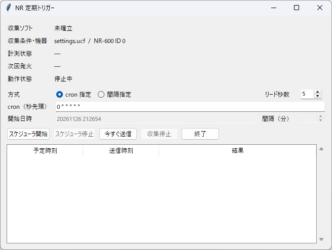

# NR-500/600 定期トリガーアプリ

キーエンス NR-600／NR-500 に対し、収集ソフト WAVE LOGGER PRO のオートメーションサーバ機能（COM）を使って、一定間隔で測定開始を送る小さな Windows アプリの設計リポジトリです。

- 設計書：[design.md](design.md)
- 詳細設計書：[detail-design.md](detail-design.md)
- 手順書：[手順書.md](手順書.md)
- 対象：NR-600 または NR-500 のいずれか1台（USB 接続、常時接続前提）
- 方式：グリッド式スケジュールで発火直前に接続を事前確立し、WAVE LOGGER PRO へ開始要求を送る。収録条件はソフト側の設定ファイルで固定し、収録中の回はスキップする。時刻の決め方は cron 指定と間隔指定（開始日時＋間隔）の2方式

## 入手と導入

実行ファイルは [Releases](../../releases) から zip で取得します。解凍してフォルダごと配置し、`config.sample.json` を `config.json` にコピーして編集すれば使えます。導入と運用の詳細は[手順書](手順書.md)を参照してください（WAVE LOGGER PRO 側の準備や、初回だけ必要な手動起動の手順を含みます）。

現行版 v0.2.2 は体験版 WAVE LOGGER PRO の環境で検証済みで、製品版＋実機での確認はこれからです。

## 参考資料（外部リンク）

制御 API の仕様は、キーエンス公式の各リファレンスマニュアルを参照してください。マニュアル本文はこのリポジトリには含めていません（取得にはキーエンス Web 会員のログインが必要です）。

- WAVE LOGGER PRO オートメーションサーバ リファレンスマニュアル（Ver.4 対応版）：キーエンス公式サイトの NR-600 シリーズ「ダウンロード」ページから取得
- [WAVE LOGGER X オートメーションサーバ リファレンスマニュアル](https://www.keyence.co.jp/products/recorder/recorder/nr-x/downloads/?mode=ma)：NR-X シリーズ「ダウンロード」ページから取得
- NR-600 シリーズ ユーザーズマニュアル：キーエンス公式サイトの NR-600 シリーズ「ダウンロード」ページから取得
