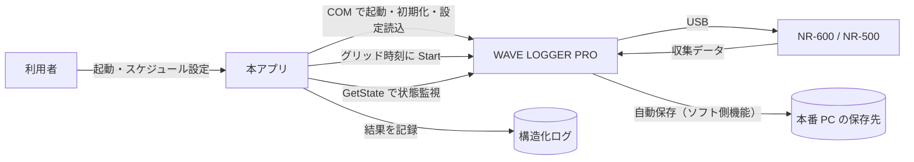

# NR-500/600 定期トリガーアプリ 設計書

版: 1.8（間隔指定モードを追加：開始日時＋間隔（分）で発火時刻を決める方式）
作成: Muse（もち）。設計レビュー: Sol（Codex）
日付: 2026-11-26
根拠資料: WAVE LOGGER PRO（WAVE LOGGER）オートメーションサーバ リファレンスマニュアル（Ver.4対応版、キーエンス公式ダウンロード AS_72099）

## 1. 目的と範囲

本番 PC 上で、キーエンスの収集ソフト WAVE LOGGER PRO に対して、TB Sync と同じグリッド時刻に「収集開始」を定期的に送るだけの小さな Windows アプリを作る。開始の送信には、WAVE LOGGER PRO の公式機能であるオートメーションサーバ（COM）を使う。

やること:
- グリッド時刻（例：毎分 00 秒）に、オートメーションサーバ経由で収集開始を1回送る
- 発火の数秒前に事前確認（状態取得）を済ませ、開始の遅れを最小化する
- 結果を構造化ログに残す

やらないこと:
- データの取得・解析・保存（保存は収集ソフト側の自動保存に任せる。前提が満たせない場合は第8節の受入で判断する）
- 収集の停止（収集条件側の設定で自動終了する前提。ただし API には Stop もあるため、非常用に画面から手動停止できるようにはする）
- 収集条件の変更（API では変更不可。条件は設定ファイル1つを読み込むだけ）

## 2. 前提（2026-11-26 確定）

| 項目 | 内容 |
|---|---|
| 本番環境 | 本番 PC（このアプリと収集ソフトが同居する。開発環境とは別の PC のため、成果物は exe＋手順書の形で渡す） |
| 開発・デバッグ | tanaka3（収集ソフトの体験版を入れてよい） |
| 対象ロガー | NR-600 または NR-500 のいずれか1台（同時接続はしない） |
| 接続 | USB、常時接続されている前提 |
| 送り先 | WAVE LOGGER PRO のオートメーションサーバ（第6節） |
| 収集条件 | 設定ファイル1つ固定。例：30秒収録し、自動で終了する条件を WAVE LOGGER PRO で作成しておく |
| 発火 | TB Sync と同じ cron グリッド式。間隔の例は1分。v1.8 で間隔指定モード（開始日時＋間隔）を追加（第5.5節） |
| 開始の遅れ | ほぼゼロが目標。Windows ティック由来の 50ms 程度は許容（定義は第5.3節） |
| 重なった回 | 収集中などで開始できない回はスキップする（TB Sync の決め方と同じ） |
| 失敗時 | ログに残すだけ（通知はしない） |
| 起動 | 手動で起動し、画面でスケジュールをセットして開始する（TB Sync と同じ） |
| 無人運用 | TB Sync と同じ扱い |

### 対応表（組み合わせごとに管理する）

| ロガー | 収集ソフト | ProgID | 検証状況 |
|---|---|---|---|
| NR-600 | WAVE LOGGER PRO（NR-H8W）Ver.4 | WaveLoggerPro2.Application（体験版は WaveLoggerPro2Demo.Application） | マニュアル確認済み。実機未検証 |
| NR-500 | WAVE LOGGER（NR-H7W、旧） | WaveLogger2.Application（体験版は WaveLogger2Demo.Application） | 同一のリファレンスマニュアルで API は共通 |
| NR-500 | WAVE LOGGER X | （X 専用のリファレンスマニュアルが別にある） | 本番 PC での使用ソフトが未確認 |

※ NR-500 の使用ソフトは本番 PC で確認する。本人の見立てでは WAVE LOGGER PRO の可能性が高い（2026-11-26）。確定したらこの表を更新する。

## 3. 全体構成

- 本アプリは新規の小規模アプリとする。TB Sync とはコードを共有しない（TB Sync は BLE 接続管理が重く、流用すると複雑さを持ち込むため）。
- 画面構成・設定ファイル形式（JSON）・スケジューラの考え方は TB Sync に寄せ、操作感と発火時刻の仕様を揃える。「TB Sync と同じ」は、同じ cron 入力から同じ予定列になることを既存の例で照合して検証する。

## 4. 画面設計（TB Sync と同じ画面）

- 収集ソフト欄：起動状態（本アプリが起動したインスタンス）、読み込んだ設定ファイル名、対象の機器 ID、現在の計測状態（GetState の表示）
- スケジュール欄：方式の選択（cron 指定／間隔指定）。cron 指定では cron 式（秒付き6フィールド、TB Sync と同じ記法）、間隔指定では開始日時（yyyymmdd hhmmss）と間隔（分）を入力する。次回発火時刻の表示
- 事前確認リード秒数：既定 5 秒（3〜5秒の範囲で設定可）
- スケジューラ開始／停止ボタン。「停止」は未送信分の取り消しまでを指す（送信済みの収集は止めない）
- 状態表示：待機中／事前確認中／送信済み／収集中／スキップ等の現在状態
- ログ欄：直近の発火結果の一覧（予定時刻、送信時刻、結果区分）
- 今すぐ送信ボタン：定期実行と同じ開始可否判定と排他を通して1回送る（動作確認用）
- 非常用に収集停止ボタン（API の Stop を呼ぶ）

## 5. 動作仕様

### 5.1 確立と事前確認

オートメーションサーバの制約として、操作できるのは**オートメーションから起動したインスタンスだけ**で、利用者が手動で開いた WAVE LOGGER PRO には接続できない。そのため運用は「本アプリが WAVE LOGGER PRO を起動して所有する」形にする。

確立（スケジューラ開始時に1回）:
1. CreateObject（ProgID は対応表）で WAVE LOGGER PRO を起動する
2. Initialize を呼ぶ
3. DisplayAlerts を False にし、警告ダイアログを抑制する。必要なら Visible を True にして画面を表示する
4. SetIdentifier で機器 ID を設定し、GetIdentifier で型式ごとの期待値との一致を確認する（起動直後の機器 ID は未設定で、設定しないと収集できない。マニュアル第6章。期待値の根拠は詳細設計 第2.2節）
5. OpenFile で固定の収集条件の設定ファイルを読み込む
6. GetState で状態を確認し、開始可能な状態（停止＝1）であることを確かめる。開始待ち＝2 で開始できるかはマニュアルに根拠が確認できないため、実機確認までは開始可能に含めない
7. GetActiveFileType で、開いた設定ファイルの型を基準値として取り込む（型の値は型式とファイルの種類で異なるため、固定値とは照合しない）

事前確認（各発火のリード秒数前に実施）:
- GetState を取り直し、対象の状態が開始可能（停止＝1）であること、状態情報が新しいことを確認する
- GetActiveFileType を確認し、確立時に取り込んだ基準値と一致すること。0（アプリが開いたファイルのウィンドウが閉じられている）なら OpenFile で開き直してから進める。基準値でも 0 でもない（別の種類のファイルがアクティブ）場合は開き直さず、その回は見送る
- 収集中（4／5／12 等）・読み出し中（10）・エラー停止（11）・状態が取れない場合は、その回は見送る。ただし締切（発火時刻）前に開始可能になれば送る
- 確立が切れていた場合（GetState が負数など）は、その回は見送り、次回までに再確立を試みる

### 5.2 送信と結果区分

- グリッド時刻ちょうどに Start を1回だけ呼ぶ。Start の戻り値 0 が正常、それ以外はエラーコード
- 呼び出し前の期限切れ（発火時刻を過ぎた）と呼び出し後の応答タイムアウトを分ける。前者は未送信の見送り。後者は遅れて開始する可能性があるため結果不明とし、再送しない
- 送信後は GetState をポーリングし、収集中の状態（3〜7、12）への遷移を確認できたら「開始確認済み」とする。WAVE LOGGER PRO 側の状態問い合わせは約200ms周期のため、確認にはその程度の遅れがありうる
- 前の呼び出しが戻っていない間は、後続の開始をキューに積まない

| 区分 | 意味 |
|---|---|
| 開始確認済み | Start の戻り値 0、かつ GetState で収集中への遷移を確認できた |
| 送信済み・未確認 | Start の戻り値 0 だが、収集中への遷移を確認できなかった |
| 見送り | 事前確認の失敗、収集中、期限切れなどで送らなかった |
| 結果不明 | 呼び出し後のタイムアウト等で、開始したかどうか分からない（再送しない） |
| 開始失敗 | Start が 0 以外のエラーコードを返した |

### 5.3 時刻の扱い

- 予定は cron グリッド（壁時計）から計算し、アプリの再起動や送信の遅れでずらさない。同じ PC 内の処理時間の計測には単調時計を使う
- 50ms 目標の定義（暫定）：**予定時刻から Start を実際に呼び出すまでの遅れ**。時刻は段階ごとに分けて記録する（予定時刻／ワーカーへ渡した時刻／呼び出し時刻／呼び出し復帰時刻／収集中を観測した時刻）
- 発火判定は画面更新・ログ書き込み・状態ポーリングから切り離し、呼び出し直前に期限を再確認する
- PC のスリープや時計補正で発火時刻を過ぎた予定は送らず、次回から再開する。復帰時の二重発火を防ぐ
- 起動直後の最初の回、cron の最短間隔が準備時間より短い場合も、上記の見送り規則で処理する

### 5.4 多重起動の防止

本アプリは単一起動とする。起動時に名前付きミューテックスで既存インスタンスの有無を確認し、既に起動している場合は「すでに起動しています」のダイアログを出して、ウィンドウもロガー接続も作らずに終了する。根拠は実測（2026-11-26）：多重起動しても二重発火はロガー側の排他（SetIdentifier の「他の WAVE LOGGER が使用中」）で防がれるが、同じログファイルへの同時書き込みで記録が欠落する（90件中22件、行の破損はなし）ため、アプリ側で単一化する。実装は詳細設計 第1節（single_instance）。

### 5.5 間隔指定モード（v1.8 追加）

cron では 60 を割り切れない間隔（7分など）を等間隔に書けないため、開始日時と間隔から発火時刻を決める方式を追加する。

- 発火時刻は「開始日時 ＋ 間隔 × k」（k＝0, 1, 2, …）。開始日時ちょうどが1回目で、間隔は分単位の整数（1以上）
- 開始日時は利用者が設定する（形式は yyyymmdd hhmmss。ISO 形式も受け付ける）。過去の日時でもよい。その場合は、その刻みの続きとして次回を計算する（位相は設定が保持するので、アプリや PC の再起動でもずれない）
- スケジューラを止めていた間の回は、まとめて送らない。過ぎた回は捨て、次回から通常運転に戻る
- 確立・事前確認・リード秒数・収録中スキップ・結果区分は cron 指定と完全に共通。違うのは次回発火時刻の計算だけ
- 時刻計算は壁時計の単純な加算とする（日本国内の運用では夏時間の影響はない）

## 6. 制御経路（オートメーションサーバで確定）

経路は WAVE LOGGER PRO のオートメーションサーバ（COM）に確定する。UI 自動化は不要になった。制御モジュールの責務は、確立（起動・初期化・設定読込）、開始可否の確認（GetState）、開始要求（Start）、発火後の観測（GetState ポーリング）とする。

主要 API（リファレンスマニュアル Ver.4対応版より）:

| API | 用途 |
|---|---|
| CreateObject("WaveLoggerPro2.Application") | WAVE LOGGER PRO を起動し、オブジェクトを得る |
| Initialize | オートメーション機能の初期化（最初に必須） |
| Visible / DisplayAlerts（プロパティ） | ウィンドウ表示、警告ダイアログ抑制 |
| OpenFile（パス） | 収集条件の設定ファイルを読み込む |
| SetIdentifier / GetIdentifier | 対応させる機器 ID の設定・取得（対象機の選択） |
| GetUnitInfo | 接続ユニット種別の取得 |
| Start | 収集開始。戻り値 0＝正常、それ以外はエラーコード。アクティブなファイルの収集条件で開始する（GUI のスタートボタンと同じ動作） |
| Stop | 収集停止（非常用） |
| GetState | 動作状態の取得。1＝停止、2＝開始待ち、3＝トリガ待ち、4／5／12＝収集中、6＝プリトリガ、7＝ポストトリガ、10＝データ読み出し中、11＝エラー停止、負数＝異常 |
| GetErrorCode | エラーコード取得 |
| Quit | WAVE LOGGER PRO の終了（本アプリの終了時） |

制約（マニュアルの制限事項より）:
- 操作できるのはオートメーションから起動したインスタンスのみ。手動で開かれた WAVE LOGGER PRO には接続できない
- イベント通知はない（収集終了やエラーは通知されない）。状態は GetState で定期的に監視する
- WAVE LOGGER PRO は本体へ約200msごとに状態問い合わせをしており、GetState の戻り値が実状態とずれることがある
- 収集条件の設定変更はできない。設定ファイルの読み込みのみ可能

Python からは COM（pywin32 の Dispatch）で呼び出す。マニュアルの対応言語は VB／VC++／VBA だが、標準的な COM オートメーションのため Python からも呼べる見込みで、体験版での疎通確認を受入項目とする。

使用する関数の選定（必須・条件付き・任意の区分、全16関数）は used-functions.md に、実装レベルの詳細設計（モジュール構成、COM スレッドモデル、判定手順、設定・ログの形式）は detail-design.md に置く。

## 7. 設定・ログ・手順書

- 設定ファイル：JSON（TB Sync と同じ形式の考え方）。ProgID、収集条件の設定ファイルのパス、機器 ID、方式（cron／間隔）、cron 式または開始日時＋間隔（分）、リード秒数を保持する
- ログ：構造化ログ（JSON Lines）。実行 ID と予定 ID で一連の流れを結び付ける。記録するもの：
  - 構成情報：アプリのビルド、Windows と収集ソフトの版、ロガー型式、ProgID、cron・タイムゾーン・リード秒数
  - 段階ごとの時刻と経過時間：予定、確立・事前確認、Start の呼び出し・復帰、収集中の観測
  - 判定に使った状態：GetState の値、Start の戻り値、GetErrorCode、状態が得られなかった理由
  - 結果区分（第5.2節）
- ログの保持：日数または総容量に上限を設ける（無制限にしない）
- 手順書に含めるもの：配置先、標準ユーザーでの起動確認、ログの場所、収集ソフトの版の確認方法、障害時に返送してもらうログ、**WAVE LOGGER PRO を手動で開いている場合は閉じてから本アプリを起動すること**、インストール後に一度だけ WAVE LOGGER PRO を手動で起動・終了しておくこと（マニュアル §6.1。これをしないとオートメーションが使えない）、設定ファイルの Excel 転送設定を OFF にすること、スケジューラ動作中は収集条件のファイルを切り替えないこと

## 8. 実機確認・受入リスト

tanaka3（体験版、実機なし）で確認できること:
1. 体験版の ProgID（WaveLoggerPro2Demo.Application）で CreateObject／Initialize／GetState までの疎通（実測済み 2026-11-26：実機なしでも GetState は停止 1 を返し、Start による収集中への遷移まで模擬動作する）
2. Python（pywin32）から COM 経由で呼べること
3. WAVE LOGGER PRO を手動で開いた状態で CreateObject するとどうなるか（二重起動／エラー等の挙動）

本番 PC（実機あり）で確認すること:
4. NR-500 側で使っている収集ソフトの製品名と版（対応表の確定）
5. 実機接続での確立手順と所要時間（USB 接続の確立が起動・初期化のどこで起きるか）
6. 自動保存の有無、ファイル名の規則（日時・連番）、保存先と形式。**固定条件で無人で連続収録したとき、毎回別ファイルに保存できることが受入条件**。満たせない場合は、追加実装の要否をここで判断する
7. 開始可否の判定ケース：収集中、収集終了後の保存・読み出し中（GetState 10）、エラー停止（11）からの復帰、手動操作との競合
8. 無人時の状態遷移：画面ロックと解除、スリープと復帰、収集ソフトの異常終了後の再確立で、誤送信せず、次のグリッドから再開すること
9. 連続運転：本番担当者が実際の配布 exe と手順書を使い、TB Sync 併走、収録と重なるグリッド、複数回の自動保存を確認する
10. 複数ウィンドウ時の挙動：体験版では実測済み（2026-11-26）。1つのインスタンスに複数の収録条件ファイルを開けて、OpenFile したファイルがアクティブになり、Start はアクティブなファイルの条件で開始した（default.ucf は即収集、Hammering.ucf はトリガ待ちと、ファイルごとに異なる開始挙動で確認。ActivateFile のインデックス指定で切替も可能）。製品版でも同じ挙動であることと、本アプリ所有分と手動で開いた分が併存した場合の挙動をここで確認する
11. 製品版での機器 ID の対応確認：GetIdentifier の取得値が型式ごとの期待値（NR-600：8＋物理 ID、NR-500：物理 ID）と一致すること。期待値は体験版（tanaka3）の実測に基づく仮定で、NR-600 は設定 4〜7 に対し取得値 8〜11 を観測済み（2026-11-26）、NR-500 は体験版で引数 0〜3 が戻り値 1 で失敗し未実測。製品版の実測と違えば、期待値の対応表を実測に合わせて直す
12. ファイルの基準値方式の確認：NR-500 用ファイル（型1）・NR-600 多チャンネルリンク用ファイル（型3）でも、確立時に取り込んだ基準値で事前確認が通り、ウィンドウを閉じた場合に開き直して回復すること（NR-600 通常ファイルの型2では tanaka3 の体験版で実測済み 2026-11-26）
13. 間隔指定モードの確認：開始日時ちょうどに1回目が発火すること、7分間隔で時をまたいでも等間隔が保たれること（毎時0分への寄せが起きないこと）、開始日時が過去の場合に位相の続きで発火すること、アプリ再起動後も位相が保たれること（tanaka3 の体験版で一部実測済み 2026-11-26、製品版でも同じ計算であること）

## 9. 実装ステップ

1. **疎通確認**：tanaka3 に WAVE LOGGER PRO 体験版を入れ、ProgID・Initialize・GetState の疎通と、手動起動済みの場合の挙動を確認する。並行して、模擬モジュール（準備が遅れる／開始が確認できない／呼び出しが戻らない、を再現できるもの）でスケジューラ・画面・ログの骨格を作る
2. **本実装と検証**：制御モジュールを実装し、tanaka3 で発火精度（段階ごとの時刻の p95・最大値、期限超過数）と繰り返し動作を検証する。実機での確認は本番 PC に exe を持ち込んで行う
3. **本番導入**：第8節の受入（実機側）を実施し、TB Sync と並べて発火時刻が揃うことを確認する

## 10. 未決事項

- NR-500 側の収集ソフトの確定（対応表）
- アプリ名と exe 名（TB Sync に倣った命名を後で決める）
- WAVE LOGGER PRO 体験版の同梱物（サンプルプログラム等）の内容確認は、インストール後に行う
