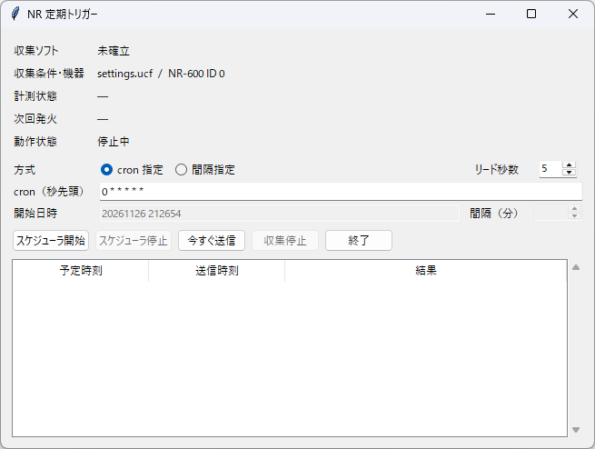

# NR-Trigger 手順書

バージョン v1.1.0（設計書 v1.9 相当）

## これは何か

キーエンス NR-600／NR-500 に対し、収集ソフト WAVE LOGGER PRO のオートメーション機能を使って、一定間隔で測定開始（Start）を送る Windows アプリです。

- 対象は NR-600 または NR-500 の**いずれか1台**（USB 接続、常時接続前提）
- 収録条件は WAVE LOGGER PRO 側の設定ファイル（.ucf）で固定し、アプリは開始だけを送ります
- 収録中の時刻に次の開始時刻が来た場合は、その回はスキップします
- 失敗した回は通知されず、ログにだけ残ります

## 動作環境

- Windows（WAVE LOGGER PRO 製品版がインストール済みの PC）
- WAVE LOGGER PRO と NR 本体が USB で接続され、通常の手動収集ができる状態であること

## 導入手順

### 1. 配置

zip を解凍し、フォルダごと任意の場所に置きます（例：`C:\NR-Trigger`）。インストール作業は不要です。アンインストールはフォルダごと削除するだけです。

### 2. WAVE LOGGER PRO 側の準備

WAVE LOGGER PRO を手動で開いた状態で、次の準備をします。

1. 収録条件ファイル（.ucf）を用意し、WAVE LOGGER PRO に読み込んで内容を確認します
   - **Start を押すだけで収録が進む条件**にしてください（トリガ待ちになる条件では、開始を送っても収録が始まりません）
   - 収録時間はソフト側の設定で自動的に終わる形にします（例：30秒収録）
2. データの自動保存を有効にします（保存先フォルダも含め、ソフト側の設定どおりに保存されます）
3. **Excel 転送設定は OFF** にします（ON だと収集のたびに Excel へ転送され、自動運転の妨げになります）

### 3. 初回だけの操作（重要）

その PC で WAVE LOGGER PRO を一度も手動で起動したことがない場合は、**一度だけ手動で WAVE LOGGER PRO を起動し、そのまま終了**してください。これをしていない PC ではオートメーション機能が有効にならず、アプリから接続できません。

### 4. 設定ファイルの作成

同梱の `config.sample.json` を `config.json` という名前でコピーし、内容を書き換えます。

接続まわりの項目（`progid`、`link_mode`、`settings_file`、`logger_model`、`unit_id`、`visible`）は、アプリのメイン画面にある「接続設定」ボタンからも変更できます。スケジューラが停止しているときだけ開けます。設定ファイルは「参照」ボタンで選べます。保存すると接続は一度切れるので、次に「スケジューラ開始」を押したときに新しい設定で接続します。入力に誤りがある場合は理由を表示して保存しません。

| 項目 | 意味 | 備考 |
|---|---|---|
| `progid` | 接続先ソフトの識別名 | 通常は `WaveLoggerPro2.Application` のまま変更不要。NR-500（無印 WAVE LOGGER）の場合は下記の節を参照 |
| `link_mode` | 接続のしかた | `full`（通常）または `simple`（送信のみ）。NR-500（無印 WAVE LOGGER）の場合は `simple` にする |
| `settings_file` | 収録条件ファイルのフルパス | 例：`C:\NR-Trigger\settings.ucf`（NR-500 側は拡張子が .xcf の場合があります。実ファイルに合わせてください） |
| `logger_model` | 接続するロガー | `NR-600` または `NR-500` |
| `unit_id` | ロガーの物理 ID | 0〜3（本体側の設定と一致させる） |
| `mode` | 開始時刻の決め方 | `cron`（時刻パターン）または `interval`（開始日時＋間隔） |
| `cron` | 開始時刻のパターン | mode が `cron` のとき使う。下記の書き方を参照 |
| `anchor` | 間隔指定の開始日時 | mode が `interval` のとき使う。`20261127 090000` の形式 |
| `interval_minutes` | 間隔指定の間隔（分） | mode が `interval` のとき使う。1以上の整数 |
| `lead_seconds` | 開始時刻の何秒前に接続を始めるか | 既定 5 のままで問題ありません |
| `visible` | WAVE LOGGER PRO の画面を表示するか | 既定 `false`（非表示） |
| `log_retention_days` | ログの保持日数 | 既定 30 |

#### NR-500（無印 WAVE LOGGER）で使う場合

NR-500 を無印の WAVE LOGGER で使う場合は、同梱の `config.sample.nr500.json` を `config.json` にコピーすると早いです。主な設定は次のとおりです。

| 項目 | 値 |
|---|---|
| `progid` | `WaveLogger2.Application` |
| `logger_model` | `NR-500` |
| `link_mode` | `simple` |
| `settings_file` | 無印 WAVE LOGGER で作成した収録条件ファイルのフルパス |

シンプルモードでは、接続の確立は「接続→機器 ID 設定→設定ファイル読み込み」だけで、開始時刻に Start を送ります。full モードとの違いは次のとおりです。

- 結果は「開始確認済み」ではなく **「送信済み」** と表示されます（Start の送信までが確認範囲で、収録が始まったかの状態確認はしません）
- 収録中かどうかを見ないため、収録中に開始時刻が来ると Start がエラーになり、その回は「開始失敗」として記録されます
- 設定ファイルが閉じられていても、開き直しはしません
- 収録中はアプリを終了できません（full モードと同じです）。先に「収集停止」してから終了してください

なお、導入手順3の「初回だけの手動起動と終了」は、無印 WAVE LOGGER でも同じく必要です。その PC で無印 WAVE LOGGER を一度も手動で起動したことがない場合は、一度だけ手動で起動して終了してください。

cron の書き方：秒・分・時・日・月・曜日の6項目をスペースで並べます。
| 例 | 意味 |
|---|---|
| `0 * * * * *` | 毎分0秒（1分に1回） |
| `0 */10 * * * *` | 10分ごと |
| `0 */30 * * * *` | 30分ごと |
| `0 0 * * * *` | 毎時0分（1時間に1回） |
| `0 0 9 * * *` | 毎日 9:00 |

#### cron の書き方（詳しく）

このアプリの cron は、先頭が「秒」の6項目です（一般的な Unix の cron は秒のない5項目で、このアプリでは使えません）。

| 項目 | 範囲 | 備考 |
|---|---|---|
| 秒 | 0〜59 | 発火する秒。通常は 0 |
| 分 | 0〜59 | |
| 時 | 0〜23 | |
| 日 | 1〜31 | |
| 月 | 1〜12 | |
| 曜日 | 0〜6 | 0＝日曜、1＝月曜、…、6＝土曜 |

各項目には次の書き方ができます。

- `*`：すべて（毎秒・毎分など）
- 数字：その値のとき（例：分に `30` ＝ 毎時30分）
- `*/n`：n ごと（例：分に `*/10` ＝ 0分、10分、20分…）
- `a-b`：範囲（例：曜日に `1-5` ＝ 月〜金）
- `a,b,c`：列挙（例：時に `9,12,15` ＝ 9時、12時、15時）

例：

| 書き方 | 意味 |
|---|---|
| `0 * * * * *` | 毎分0秒（1分に1回） |
| `0 */5 * * * *` | 5分ごと |
| `0 */10 * * * *` | 10分ごと |
| `0 */30 * * * *` | 30分ごと |
| `0 0 * * * *` | 毎時0分（1時間に1回） |
| `0 0 */2 * * *` | 2時間ごと（偶数時の0分） |
| `0 0 9 * * *` | 毎日 9:00 |
| `0 30 3 * * *` | 毎日 3:30 |
| `0 0 9,18 * * *` | 毎日 9:00 と 18:00 |
| `0 0 9 * * 1-5` | 平日（月〜金）の 9:00 |
| `0 30 9 * * 1-5` | 平日（月〜金）の 9:30 |
| `0 0 8 * * 1` | 毎週月曜の 8:00 |
| `0 0 9 1 * *` | 毎月1日の 9:00 |
| `0 0 0 1 * *` | 毎月1日の 0:00 |

注意：**60で割り切れない間隔は、厳密な等間隔になりません。** たとえば7分ごとは `0 */7 * * * *` と書けますが、発火は毎時 0・7・14・…・56分となり、56分→次の0分の間だけ4分間隔になります。cron は1時間（や1日）の中でパターンを繰り返す書き方なので、2・3・4・5・6・10・12・15・20・30分など60を割り切れる間隔だけが均等になります。厳密に7分間隔で通したい場合は cron では書けません。

#### 間隔指定モード（等間隔で送りたい場合）

7分間隔のような、cron で等間隔に書けない間隔は、間隔指定モードで指定します。画面の「方式」で「間隔指定」を選び、開始日時と間隔（分）を入力します（設定ファイルでは `mode` を `interval` にし、`anchor` と `interval_minutes` を書きます）。

- 発火は「開始日時、開始日時＋間隔、開始日時＋間隔×2、…」で、開始日時ちょうどが1回目です
- 開始日時の欄には、アプリを起動した時刻があらかじめ入っています。そのまま使えば「起動した時刻から間隔ごと」になります。計画に合わせたい場合は、開始日時を書き換えてください
- 開始日時には過去の日時も指定できます。その場合は、その刻みの続きとして次回が計算されます（アプリや PC を再起動しても、刻みは設定どおりに保たれます）
- アプリを止めていた間の回は、まとめて送り直しません。過ぎた回は捨てて、次回から通常運転に戻ります
- 収録中の回をスキップする扱いや、開始前の接続確立は cron のときと同じです

### 5. 起動前の確認

- **手動で開いている WAVE LOGGER PRO は閉じてください。** アプリが操作できるのは、自分で起動した WAVE LOGGER PRO だけです。手動で開いたものには接続できません
- NR 本体の電源と USB 接続を確認します

## 使い方

`NR-Trigger.exe` をダブルクリックで起動します（手動起動です。自動起動の設定はありません）。

WAVE LOGGER PRO は、自分で起動しておく必要はありません。アプリが「スケジューラ開始」のタイミングで起動して接続し、終了するときに一緒に終了します（設定 `visible` が `false` の場合は、画面に出ないまま起動します）。

### 基本の流れ

1. **始める前の状態**：上の「起動前の確認」のとおり、WAVE LOGGER PRO が手動で開いていない状態にしておきます
2. **アプリを起動する**：`NR-Trigger.exe` をダブルクリックします。画面は開きますが、この時点ではまだ接続していません（収集ソフトは「未確立」）
3. **「スケジューラ開始」を押す**：アプリが WAVE LOGGER PRO を起動し、設定ファイル（.ucf）を読み込んで接続します。「確立済み」・運転中になったら、あとは開始時刻のたびに自動で開始が送られます（設定ファイルは、ロガー側で先に開いておく必要はありません）
4. **止めるとき**：定期送信だけを止めるなら「スケジューラ停止」（接続は維持されます）。すべて終わらせるなら「終了」を押します

| 表示・ボタン | 意味 |
|---|---|
| 収集ソフト | WAVE LOGGER PRO との接続状態（未確立／確立済み） |
| 収集条件・機器 | 設定ファイル名と、対象ロガー・ID |
| 計測状態 | ロガー側の状態 |
| 次回発火 | 次に開始を送る予定時刻 |
| 動作状態 | 停止中／運転中 |
| スケジューラ開始 | 定期送信を開始します |
| スケジューラ停止 | 定期送信を止めます（接続は維持されます。ソフトごと終わらせるには「終了」を使います） |
| 今すぐ送信 | その場で1回だけ開始を送ります（動作確認用。スケジューラを開始して「確立済み」になってから使ってください） |
| 収集停止 | 収録中の収集を止めます（次回の定期送信はそのまま有効です） |
| 終了 | アプリを終了します |

結果の一覧には、予定時刻・送信時刻・結果（開始確認済み／見送り／結果不明など）が1回ごとに記録されます。

## 運用上の注意

- **動作中に WAVE LOGGER PRO のファイル（収録条件）を切り替えないでください。** 開始は、その時点でアクティブなファイルの条件で実行されます。アプリが開いたファイルが閉じられていた場合は、アプリが自動で開き直します
- アプリは二重起動できません。2つ目を起動すると「すでに起動しています」と表示されて終了します
- 収録が終わらないうちに次の開始時刻が来た回はスキップされ、結果一覧とログに残ります
- PC をスリープさせると定期送信は止まります。無人で回す場合はスリープしない設定にしてください

## ログ

exe と同じフォルダの `logs` フォルダに、日付ごとのログファイルが残ります。うまく動かないときは、このログが切り分けの手がかりになります（保持日数は設定で変更できます）。

## うまく動かないとき

| 症状 | 確認すること |
|---|---|
| 収集ソフトが「未確立」のまま | 導入手順3（初回だけの手動起動・終了）を実施したか／手動で開いた WAVE LOGGER PRO が残っていないか |
| 「確立が応答待ち」「収集ソフトが応答待ち」と出る | WAVE LOGGER PRO 側の処理が30秒以上戻っていません。ソフト側でダイアログが出ていないか確認し、解消しない場合は WAVE LOGGER PRO とアプリを再起動してください |
| 「他の WAVE LOGGER が使用中」と出る | 他に開いている WAVE LOGGER PRO をすべて閉じてから、アプリを起動し直す |
| 開始を送っても収録が始まらない | 収録条件が「Start だけで進む条件」になっているか（トリガ待ちの条件になっていないか） |
| 予定時刻に送信されない | cron の書き方／PC の時計／PC がスリープしていなかったか |
| 結果が「見送り」になる | 理由はいくつかあります。前の収録が終わっていない場合は、収録時間に対して間隔が短すぎないか確認してください。それ以外では、接続が確立していない（収集ソフトが「未確立」）場合や、開始直前の状態確認が間に合わなかった場合にも見送りになります。理由はログに残ります |
| 結果が「結果不明」になる | 開始を送ったものの、開始したかどうか締切までに確定しなかった回です。遅れて開始している可能性があるため、もう一度送る前に、ロガー側で収録が始まっていないか確認してください |

## 検証状況（v1.1.0）

- v1.1.0 では、NR-500（無印 WAVE LOGGER）向けの「シンプルモード」（`link_mode: "simple"`）を追加しました。確立チェックと状態確認を省き、接続して Start を送ることに絞ったモードです（詳しくは「NR-500（無印 WAVE LOGGER）で使う場合」の節）。体験版 WAVE LOGGER PRO をシンプルモードで駆動する実リンク確認まで済んでいますが、無印 WAVE LOGGER＋NR-500 の実機での確認は未実施です
- v1.0.0 では、アプリ名を「NR-Trigger」、exe 名を「NR-Trigger.exe」に正式決定し、正式版としました（機能の変更はありません）
- v0.2.2 では、収集ソフトが応答しなくなった場合に検知して止める仕組み、切断後に再接続できなくなる経路の修正、確立条件の厳密化（設定ファイルの種類を確認できない場合は確立失敗にする）、再接続の間隔の調整、設定値の範囲チェックなどを入れました
- v0.2.1 では、予定時刻より前にスケジューラを停止して再開した場合（および初回接続に失敗して再試行した場合）に、その予定が欠落する不具合を修正しました。あわせて手順書の cron 例の誤記を訂正しています

- 開発環境（体験版 WAVE LOGGER PRO＋実機なしの模擬収集）で、接続確立・開始送信・スケジュール精度（予定時刻とのずれ 15ms 以下）・収録中スキップ・二重起動防止・ファイル開き直しまで確認済みです。間隔指定モードも、開始日時ちょうどの発火・等間隔の継続・過去の開始日時からの位相継続を同じ環境で確認済みです
- **製品版＋実機での確認はこれからです。** 初回は、まず「スケジューラ開始」を押して収集ソフトが「確立済み」になったことを確認し、「今すぐ送信」で1回だけ開始を送って、実際に収録と保存が行われることを目視で確認してください（「今すぐ送信」は、スケジューラを開始していないと送れません）。確認できたら、そのまま定期送信を続けてください
